# 团队工作室 · 图文使用手册

> 一看就会：团队功能就在你每天用的 newbee 主界面里，不用跳去别的页面。
> 本手册每一步都配了真实界面截图。适用版本：main `fe8c282` 起。

---

## 它能帮你做什么

你说一句"要做什么"，系统就帮你**组建一支 AI 团队**（产品经理、UI 设计师、架构师、研发、测试……），
团队按流程**一环扣一环地干活**，每环产出成果交给你**验收**：满意就进入下一环，不满意就**打回重做**，
全部做完还能**带着反馈再来一轮**。你只负责拿主意，干活交给团队。

```
你提目标 → 团队按阶段干活 → 你验收 ──通过──→ 下一阶段
                              └──打回──→ 回到对应环节重做
全部通过 → 你确认：结束 / 继续迭代
```

---

## 第 1 步：找到入口（顶栏 🐝 按钮）

打开 newbee 主界面（就是你平时对话的那个页面）。看**顶栏右侧**，有一个**六边形金色按钮**：

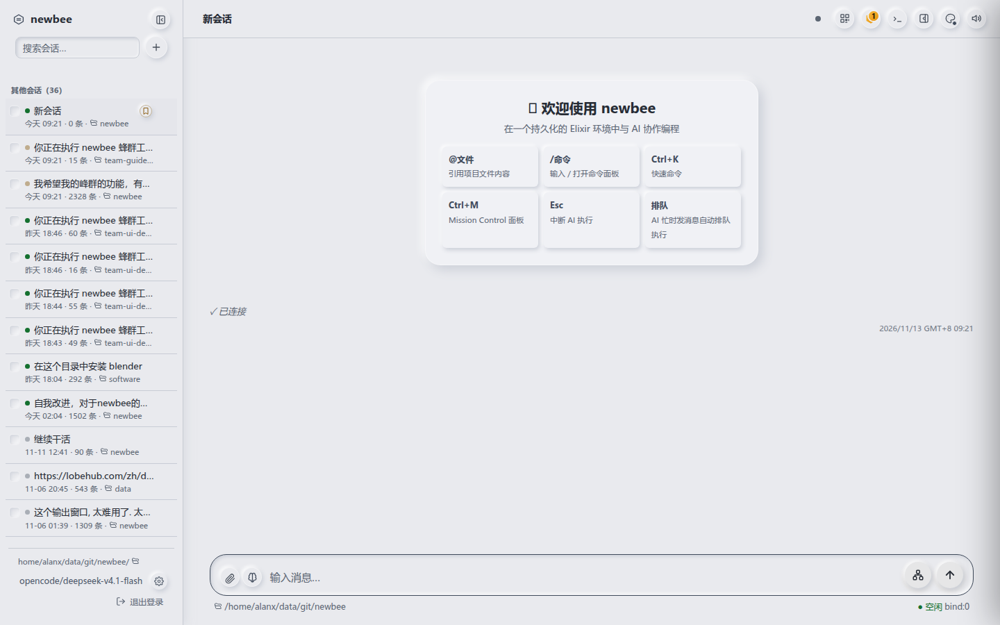

按钮特写——有项目等你处理时，右上角会亮起**金色数字徽标**（下面这个"1"表示有 1 件事等你验收）：


> 💡 **徽标就是提醒**：数字 > 0 说明有项目等你验收/确认/处理。不用一直盯着，看到数字再点进来。

---

## 第 2 步：打开面板，认识三个页签

点 🐝 按钮，右侧滑出「团队工作室」面板：

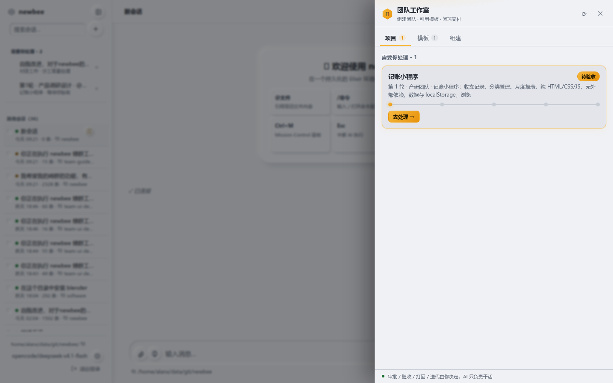

顶部三个页签：

| 页签 | 干什么 |
| --- | --- |
| **项目** | 看进行中的团队项目，验收/打回/迭代都在这里 |
| **模板** | 浏览团队模板，一键开项目 |
| **组建** | 让 main 帮你定制一支新团队 |

**需要你处理的项目会自动高亮、排在最前**（金色边框那张卡片）。每张卡片下面有一排小圆点，是**阶段进度轨道**：绿点=已完成，金点=当前环节。

> 按 `Esc` 或点右上角 ✕ 关闭面板，回到对话。

---

## 第 3 步：开一个项目（最快 30 秒）

### 方式 A：用内置「产研团队」模板（推荐新手）

1. 切到 **「模板」** 页签：

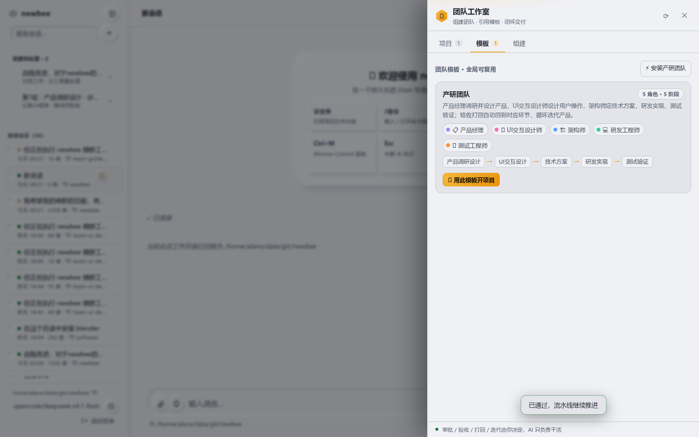

   每张模板卡片上能看到：**角色**（彩色小标签：📋产品经理 🎨UI设计师 🏗️架构师 💻研发 🧪测试）和**阶段流水线**（产品调研→UI设计→技术方案→研发→测试）。

2. 点 **「🚀 用此模板开项目」**，卡片下方展开表单：

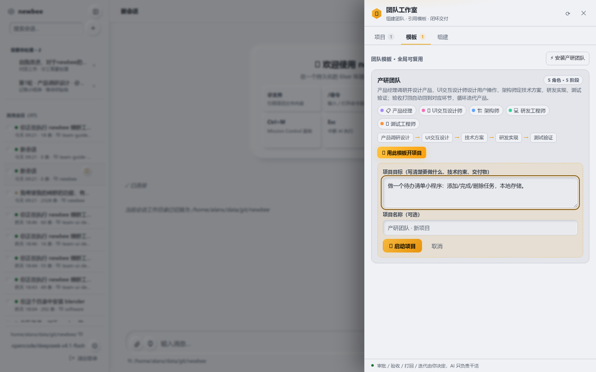

3. 在「项目目标」里**写清楚要做什么**。越具体越好，例如：
   > 做一个纯前端记账小程序：收支记录、分类管理、月度报表。纯 HTML/CSS/JS，无外部依赖，数据存 localStorage，浏览器直接打开 index.html 可用。

4. 点 **「🚀 启动项目」**。

**完成！** 系统立刻建好 5 个 AI 角色，把第一阶段（产品调研设计）派给产品经理。面板自动跳到「项目」页，你就能看到新项目了。

> 如果模板页是空的，点右上角 **「⚡ 安装产研团队」** 一键装好内置模板。

### 方式 B：让 main 定制团队

想要别的团队结构（内容团队、运营团队……），见 [第 7 步](#第-7-步让-main-组建自定义团队)。

---

## 第 4 步：验收阶段成果

团队干完一个阶段，会停下来等你验收。这时顶栏徽标亮起，项目卡片高亮。

1. 在「项目」页点高亮卡片的 **「去处理 →」**，展开详情：

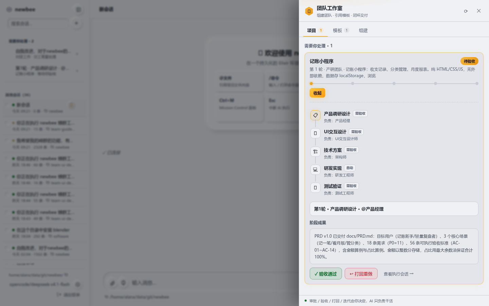

   你能看到：
   - **阶段流水线**：✓ 已完成 / 高亮当前 / 待开始，每环标了负责角色和闸门（需验收/自动）。
   - **阶段成果**：这一环产出的文档/代码说明全文，直接在这里读。
   - **最近反馈**：如果上一轮被打回过，这里显示打回理由。

2. 读完成果，点 **「✓ 验收通过」**，填一句意见（可选）：

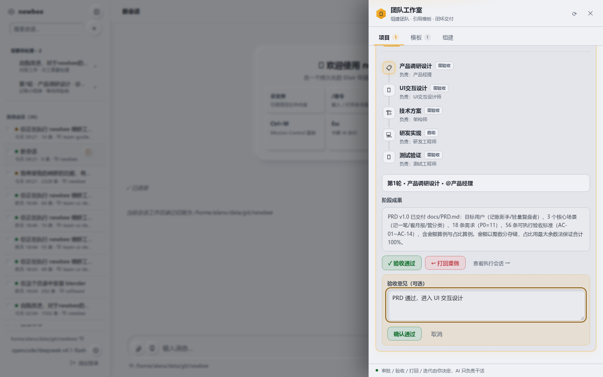

3. 点 **「确认通过」**。流水线立刻推进到下一阶段：

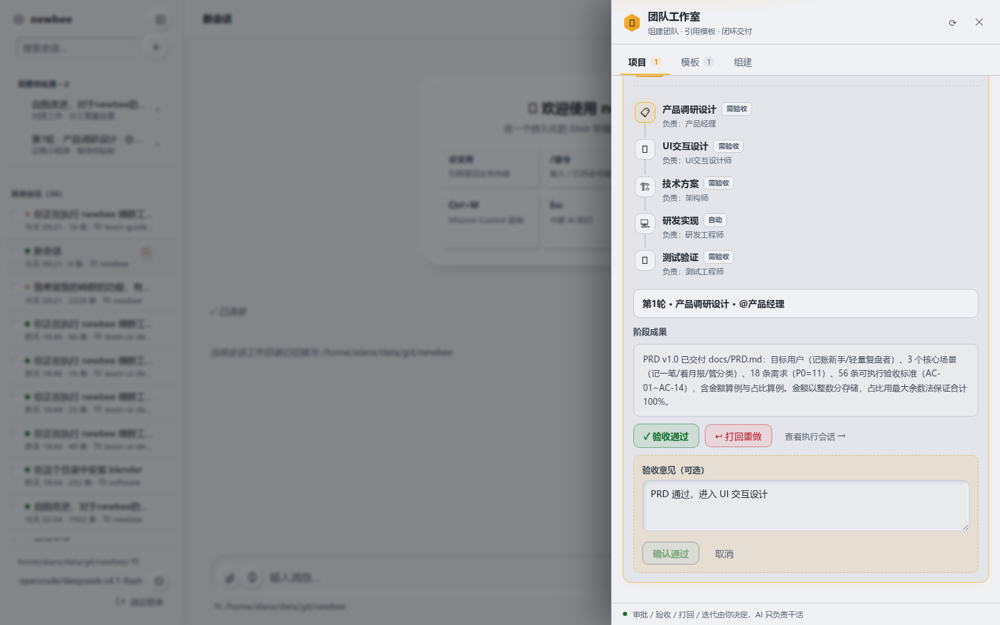

> 🔍 想看角色具体怎么干的？点详情里的 **「查看执行会话 →」**，直接跳到它的真实工作会话。

---

## 第 5 步：不满意？打回重做

成果不行就打回，团队会回到对应环节重做，**你的打回理由会作为反馈交给重做的角色**。

1. 在项目详情点 **「↩ 打回重做」**。
2. **必填打回理由**——写清楚哪里不行、要改成什么样：

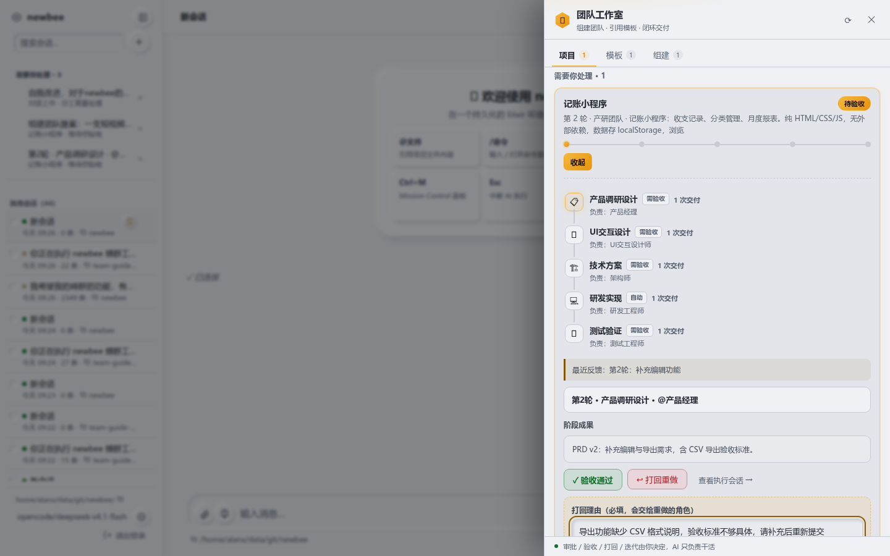

3. 点 **「确认打回」**。

打回后：轮次 +1，项目回到该阶段设定的回退环节（比如测试打回→研发，架构打回→UI设计），角色带着你的反馈重新干。

> ⚠️ 打回次数有上限（模板的轮次预算）。用尽后项目会停下等你"提高预算"，不会无限循环。

---

## 第 6 步：全部做完——结束或继续迭代

最后一个阶段验收通过，项目变成 **「待你确认」**：

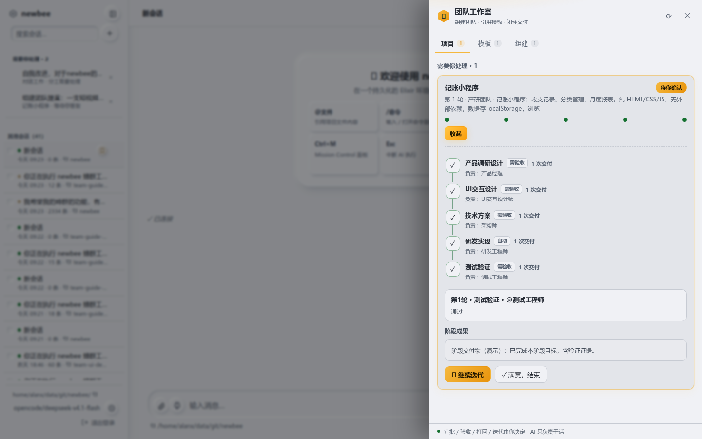

两个选择：

- **「✓ 满意，结束」**：项目关闭，交付完成。
- **「🔁 继续迭代」**：带着反馈再来一轮。点它，填下一轮要改进什么：

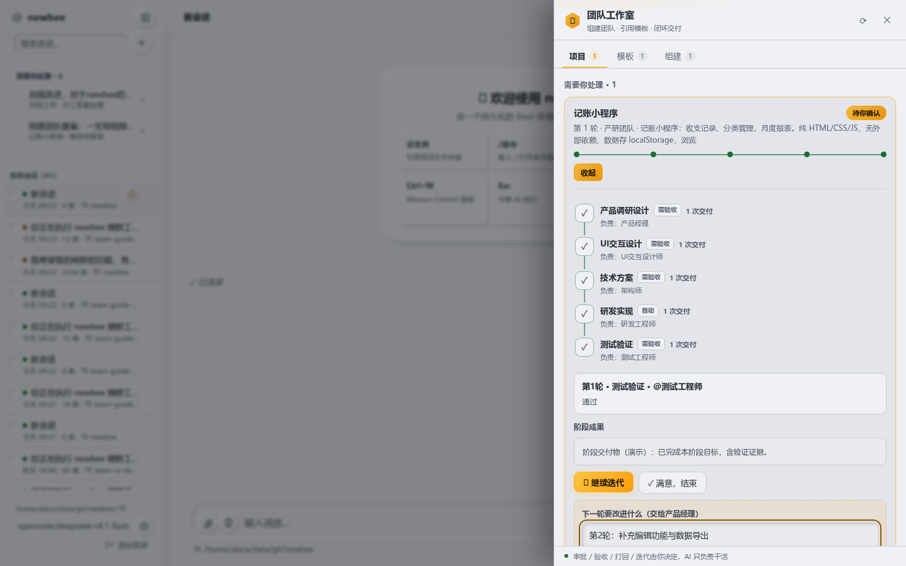

   例如"第2轮：补充编辑功能与数据导出"。确认后团队回到第一阶段（产品经理），带着你的反馈开始新一轮。

> 轮次预算用尽被停下的项目，详情里会出现 **「⤴ 提高预算并继续」**，追加 1~5 轮即可恢复。

---

## 第 7 步：让 main 组建自定义团队

1. 切到 **「组建」** 页签：

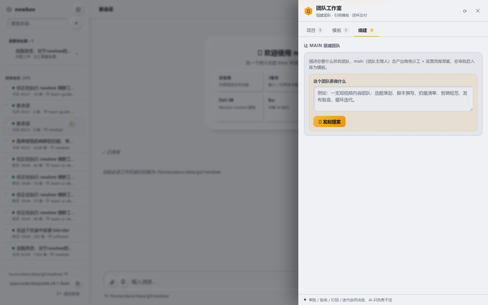

2. 在「这个团队要做什么」里描述，例如：
   > 一支短视频内容团队：选题策划、脚本撰写、拍摄清单、剪辑规范、发布复盘，循环迭代。

3. 点 **「👑 发起提案」**。系统创建「团队主理人」(main) 开始规划。

4. 等草案就绪（状态从"main 规划中"变成"草案待审批"，刷新面板查看），点该提案查看：

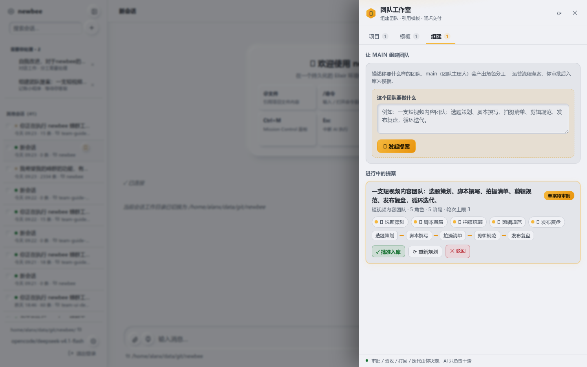

5. 三个按钮：
   - **「✓ 批准入库」**：模板成为全局资产，以后在「模板」页就能引用开项目。
   - **「⟳ 重新规划」**：草案不满意，填意见让 main 重做（最多 5 次）。
   - **「✕ 驳回」**：不要这个方案。

> 🔒 **审批是你的专属权力**，AI 不能替你批准。

---

## 第 8 步：手机上也能用

面板在手机上自动占满全屏，操作完全一样：

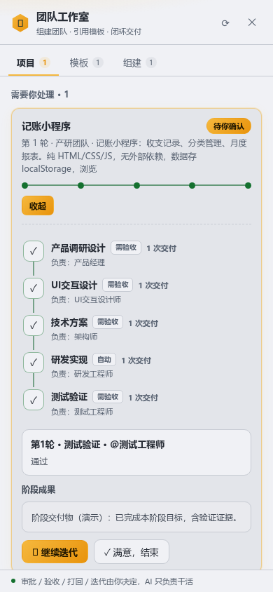

---

## 常见问题

**Q：点了启动项目，角色没动？**
阶段任务是异步启动的，稍等几秒刷新。长时间不动看详情里当前任务的提示；可能是模型凭据没配（在主界面模型设置里修）。

**Q：任务卡在"受阻 / 执行回执丢失"？**
这是系统保护（不自动重放未知操作）。在详情里看提示，或到对应执行会话里让它继续。系统繁忙时偶发，恢复即可。

**Q：某个角色反复做无效操作？**
系统的 watchdog 会自动裁决停止。你也可以中断它的会话、补充明确指令。必要时人补位完成该阶段，再让角色提交。

**Q：模板能改吗？**
模板版本固定 v1，进行中的项目用启动时的快照。要不同结构就让 main 组建新模板。

**Q：能同时跑多个项目吗？**
能。每次开项目都是独立的，互不干扰。

**Q：普通成员能验收吗？**
不能。审批/验收/打回/迭代需要管理权限，普通成员只能查看。

---

## 一页速查

```
入口：      主界面顶栏 六边形🐝按钮（有待办亮金色数字）
开项目：    模板页 → 用此模板开项目 → 填目标 → 启动
验收：      项目页 → 去处理 → 读成果 → ✓验收通过
打回：      项目页 → 去处理 → ↩打回重做 → 填理由
迭代：      项目走完 → 🔁继续迭代(填反馈) / ✓满意结束
提预算：    轮次用尽 → ⤴提高预算并继续
定制团队：  组建页 → 填目标 → 发起提案 → 等草案 → ✓批准入库
看过程：    项目详情 → 查看执行会话
```

> 模型也能帮你开项目/查状态（对话里说"用产研团队开项目做XXX"），
> 但**审批、验收、打回、迭代必须你在面板里点**——这是你的专属权力。
